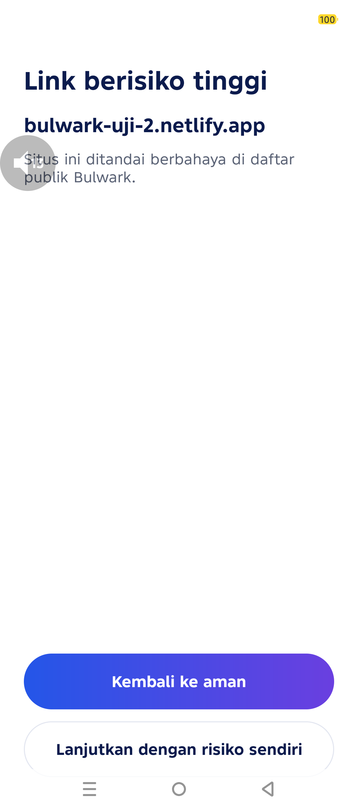
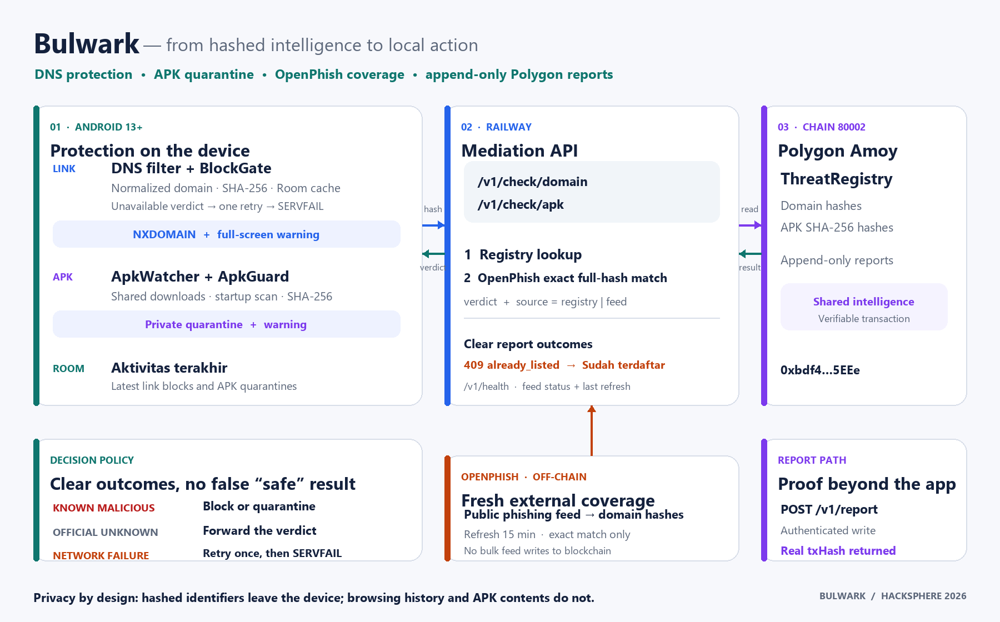

<div align="center">

# 🛡️ Bulwark
### Protection before the tap becomes a compromise.

**An Android security companion that warns users about known scam links, quarantines known-malicious APK downloads, and turns new reports into shared threat intelligence.**

Built for **Hacksphere 2026** · Team *Aku Mau Skin Kuronami Vandal* · Android 13+ · Kotlin · Node.js · Polygon Amoy

[Download the app](https://github.com/royaldinan/Bulwark/releases/latest/download/bulwark-demo.apk) · [Architecture](#architecture) · [Live API](https://bulwark-production-d29c2d86.up.railway.app/v1/health) · [Registry contract](https://amoy.polygonscan.com/address/0xbdf4a4db5C00f2172435940efD8f460ff8f15EEe)

</div>

---

## Why Bulwark

A single WhatsApp message can move a victim from a familiar chat to a fake giveaway, a credential-harvesting page, or an APK download in seconds. Centralized blocklists protect a browser; Bulwark brings the decision closer to the person and lets every user strengthen the same shared registry.

| Signal | Value |
| --- | --- |
| Reported scam losses in Indonesia (14 months) | **IDR 9.1T**, under 2% recovered |
| Scam links arriving through chat apps | **89%** via WhatsApp |
| Adults who encountered a scam in the last 12 months | **66%** |

Sources: OJK IASC (2026), GASA State of Scams Indonesia 2025, PANDI IDADX Q4 2025, APJII 2025.

## What the MVP delivers

| Protection | User experience | Enforcement |
| --- | --- | --- |
| **Scam-link protection** | A full-screen warning appears over the current app. The user can return to safety or make an informed choice to continue. | A local DNS filter answers known-malicious domains with NXDOMAIN and deduplicates repeated warnings. |
| **APK download quarantine** | A clear warning identifies the threat without technical jargon. | A known-malicious APK is removed from the watched download location and moved to app-private quarantine so the installer cannot open the original file. |
| **Expanded threat coverage** | Protection benefits from intelligence beyond reports made by Bulwark users. | Registry lookups are complemented by an off-chain OpenPhish domain index using exact SHA-256 matches. |
| **Resilient verdict handling** | A temporary network problem is not silently presented as a safe result. | An unavailable verdict receives one bounded retry, then fails safely; an official UNKNOWN verdict remains distinct. |
| **Useful report feedback** | Duplicate submissions show **“Sudah terdaftar”**, not a misleading connection error. | The API returns a dedicated `409 already_listed` outcome while preserving real registry errors. |
| **Recent protection activity** | The home screen shows the latest link blocks and APK quarantines with their source and time. | Events come from Room on the device, not hardcoded dashboard data. |

## Product preview

<p align="center">
  
  
</p>

## Architecture



### From a link to a decision

1. An app resolves a domain through Bulwark’s local, permission-based DNS filter.
2. The domain is normalized and hashed with SHA-256. The device checks its Room cache before making a network request.
3. The mediation API checks the shared Polygon Amoy registry. On a registry miss, it checks the current OpenPhish domain-hash index.
4. A known-malicious verdict returns a warning and NXDOMAIN. A verified verdict is cached for subsequent lookups.
5. A transient unavailable verdict is retried once; it is never cached as UNKNOWN.

### From an APK download to quarantine

1. `ApkWatcher` observes supported shared download folders, including folders created after protection starts.
2. New and already-present APKs are hashed locally with SHA-256.
3. `ApkGuard` checks the hash against the shared registry and caches the result.
4. A known-malicious file is moved into app-private quarantine and recorded in Room. The user sees a warning and the event appears under **Aktivitas terakhir**.

### Shared intelligence, without putting every feed entry on-chain

The Polygon registry stores community-reported domain and APK hashes. OpenPhish is imported into an off-chain exact-hash index and refreshed every 15 minutes. This keeps lookups fast while retaining an append-only, independently verifiable reporting trail.

The phone sends hashed identifiers to the mediation API—not browsing history or APK contents. Link events, APK events, cache entries, and recent activity remain in the device’s Room database.

## Live, verifiable evidence

| Check | Result |
| --- | --- |
| Android automated suite | **60 JVM tests passing** across DNS decisions, retry behavior, reporting, recent activity, and APK watching |
| Backend automated suite | **33 tests passing** across registry mediation, OpenPhish ingestion, health reporting, and duplicate handling |
| Android build | **assembleDebug — BUILD SUCCESSFUL** |
| WhatsApp link scenario | Scam simulation link received in WhatsApp resolves through Bulwark and opens the warning experience |
| Chrome APK scenario | Owner-confirmed on Infinix Note 40: the downloaded fixture was quarantined and the Android installer did not open |
| OpenPhish integration | Live API returned `malicious / feed` for an OpenPhish domain that was previously `unknown / none` in Bulwark |
| Duplicate report | Live API returns **HTTP 409** with `{"error":"already_listed"}` |
| On-chain proof | [Verified Polygon Amoy transaction](https://amoy.polygonscan.com/tx/0x9603e19c40de89d28a39db04208c66c912c886a34dd2df90d76d2730d929754d) |
| APK fixture registration | [Verified Polygon Amoy transaction](https://amoy.polygonscan.com/tx/0xb2ce6f3be64fb652b5913b4db80a2057232dcd6e7847385290f15446046a9764) |

## Try the evaluation build

**Requirements:** Android 13 or newer. Enable Chrome’s standard network mode and allow Bulwark’s local connection filter, warning display, and file-access permissions during onboarding.

1. Download **[bulwark-demo.apk](https://github.com/royaldinan/Bulwark/releases/latest/download/bulwark-demo.apk)** from the latest release.
2. Complete the three-step onboarding and activate protection.
3. Send the safe simulation page to yourself on WhatsApp: <https://bulwark-simulasi-scam.netlify.app>.
4. Tap the link and observe the warning. The site is a controlled simulation, not a real scam.
5. For APK quarantine, send the harmless **[HadiahGratis.apk](https://github.com/royaldinan/Bulwark/releases/latest/download/HadiahGratis.apk)** link through WhatsApp, open it in Chrome, and download it.
6. Open **Aktivitas terakhir** in Bulwark to inspect the recorded protection event.

The fixture is a harmless, permission-free application with package ID `id.bulwark.fixture.hadiah`. Its SHA-256 is intentionally registered as malicious solely to exercise the protection flow:

```text
9ab8df25f7e455500bab400399434972f3bfa74652e1df641a8df92938f590ef
```

## Run locally

### Android

Requirements: **JDK 21**, Android SDK 36.

Create the gitignored `android/local.properties`:

```properties
sdk.dir=C\:\Users\<you>\AppData\Local\Android\Sdk
API_BASE_URL=https://bulwark-production-d29c2d86.up.railway.app
API_SHARED_TOKEN=<report-token>
```

Then build and test:

```bash
cd android
./gradlew testDebugUnitTest assembleDebug
```

The APK is generated at `android/app/build/outputs/apk/debug/app-debug.apk`.

### Backend

```bash
cd backend
cp .env.example .env
# Fill AMOY_RPC_URL, REGISTRY_ADDRESS, API_SHARED_TOKEN and PRIVATE_KEY.
npm install
npm test
npm run dev
```

Health endpoint: <https://bulwark-production-d29c2d86.up.railway.app/v1/health>. Its `feed` object reports the provider, entry count, last refresh, and any refresh error.

### Smart contract

```bash
cd contracts
cp .env.example .env
npm install
npx hardhat test
```

## API

Base URL: `https://bulwark-production-d29c2d86.up.railway.app`

| Method | Endpoint | Request body | Purpose |
| --- | --- | --- | --- |
| `GET` | `/v1/health` | — | API, registry, and OpenPhish feed health |
| `POST` | `/v1/check/domain` | `{"prefix":"0x…16 hex","hash":"0x…64 hex"}` | Exact domain verdict from registry or feed |
| `POST` | `/v1/check/apk` | `{"sha256":"0x…64 hex"}` | APK SHA-256 verdict |
| `POST` | `/v1/report` | `{"kind":"domain" or "apk","hash":"0x…64 hex"}` + `x-api-token` | Append a report and return its real `txHash` |

```bash
curl https://bulwark-production-d29c2d86.up.railway.app/v1/health
```

## On-chain registry

| Item | Value |
| --- | --- |
| Contract | [`Registry.sol`](contracts/contracts/Registry.sol) |
| Address | [`0xbdf4a4db5C00f2172435940efD8f460ff8f15EEe`](https://amoy.polygonscan.com/address/0xbdf4a4db5C00f2172435940efD8f460ff8f15EEe) |
| Network | Polygon Amoy · chain ID `80002` |
| Write path | Android → Railway API → Amoy transaction receipt |
| Domain read path | Room cache → Railway API → Amoy registry → OpenPhish exact-hash index |

## Repository map

```text
android/                 Kotlin · Jetpack Compose · Room · DNS filtering · APK quarantine
  app/src/test/          JVM regression suites
  fixture/               Harmless APK quarantine fixture
backend/                 Express mediation API · OpenPhish index · registry writes
contracts/               Solidity ThreatRegistry · Hardhat tests · deployment scripts
docs/                    Architecture · product requirements · team · real screenshots
```

## Team

| Contributor | Area |
| --- | --- |
| [Ferdinand Manurung](https://github.com/royaldinan) | Team lead · Android protection core · DNS decisions · on-device verification |
| [Abyan Nur Zaky](https://github.com/anzuky1) | Backend · smart contract · Railway · Polygon Amoy integration |
| [Mario Gabriel Santoso](https://github.com/MarioGess) | Compose UI · onboarding · APK monitoring and quarantine experience |

See [docs/TEAM.md](docs/TEAM.md) for engineering conventions and [docs/PRD.md](docs/PRD.md) for product requirements.

## License

[MIT](LICENSE) © 2026 Ferdinand Manurung, Abyan Nur Zaky, Mario Gabriel Santoso

---

<div align="center">
<strong>Bulwark — shared intelligence. Local action. A safer next tap.</strong><br/>
Built for Hacksphere 2026.
</div>
