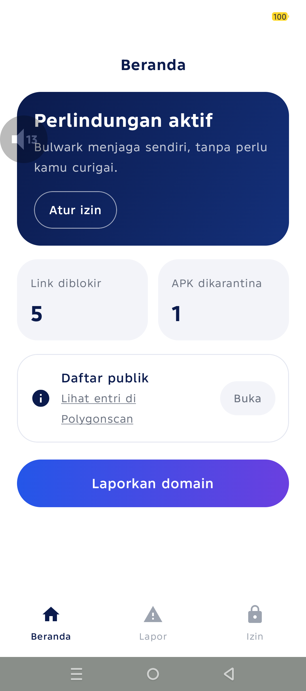

# Bulwark

**Stop scams before the tap.**

Bulwark is an Android shield that closes scam links at the DNS layer and moves known-malicious APKs into quarantine before they can be installed. Verdicts live in a public, append-only registry on Polygon Amoy, so a report from one phone protects every phone that runs Bulwark.

Hacksphere 2026 · Team *Aku Mau Skin Kuronami Vandal*

---

## Download the demo build

[**bulwark-demo.apk**](https://github.com/royaldinan/Bulwark/releases/latest/download/bulwark-demo.apk) · Android 8.0+ · `id.bulwark`

Install it, open the app once, and grant the three permissions it asks for: VPN, display over other apps, and all-files access. The tunnel starts immediately; the home screen shows *Perlindungan aktif*.

This is a debug-signed demo build pointed at the live Railway API. Source builds are described under [Quick start](#quick-start).

---

## The problem

| Signal | Value |
| --- | --- |
| Reported scam losses in Indonesia (14 months) | **IDR 9.1T**, under 2% recovered |
| Scam links that arrive through chat apps | **89%** via WhatsApp |
| People who feel confident they can spot a scam, yet were scammed | **31%** |
| Adults who met a scam in the last 12 months | **66%** |

Blocklists exist, but they act *after* someone reports. The tap happens first — and an APK installed once can read SMS OTPs in seconds. Bulwark checks at the moment a connection or a file arrives, not when the user becomes suspicious.

Sources: OJK IASC (2026), GASA State of Scams Indonesia 2025, PANDI IDADX Q4 2025, APJII 2025.

---

## How it works

**1 · Detect**
A local `VpnService` tunnel receives every DNS lookup on the device. A `FileObserver` watches the Download folder and the WhatsApp documents folder; each new `.apk` is hashed with streaming SHA-256.

**2 · Decide**
The device cache answers in milliseconds. On a miss the app asks the registry through the mediation API. Only a 16-hex prefix of the hash leaves the phone; unknown domains are forwarded to the upstream resolver untouched.

**3 · Act**
- **Link:** no DNS answer is returned, so the page never loads. A full-screen warning names the domain and offers *stay safe* or *continue at your own risk* (a 5-minute pass, then the gate blocks again).
- **APK:** a malicious package is moved out of the folder into the app's private quarantine, so it can never be installed.
- **Report:** a domain or APK hash submitted from the app becomes a public on-chain entry with a real transaction hash.

---

## Architecture


**Android** — Kotlin, Jetpack Compose, Room, `VpnService`, `FileObserver`, streaming SHA-256.
**Backend** — Node.js/Express mediation API in front of the registry, in-process cache, request validation, rate limiting.
**Contracts** — `Registry.sol`: append-only verdicts, owner-gated writes, no delete path.

---

## On a real phone

<table>
<tr>
<td width="50%"><br><sub>Home: protection active, live counters.</sub></td>
<td width="50%"><br><sub>Warning: the domain is named before the page loads.</sub></td>
</tr>
</table>

Every claim below was executed on an Infinix X6853 (Android 14) with the tunnel connected (`VPN CONNECTED extra: VPN:id.bulwark`); each result is backed by a screen dump **and** a logcat line or a database row.

| What | Result |
| --- | --- |
| Scam link in Chrome | Blocked at DNS (`NXDOMAIN`), full-screen warning, `link_event` saved, counter +1 |
| Scam link tapped inside WhatsApp | Same block, warning opens over the chat, `link_event` saved |
| Repeat visits | Warning returns on every new visit; 15-second cooldown after closing, never extended by suppressed queries |
| Malicious APK in Download | Moved to quarantine, warning shown, `apk_event` recorded, counter +1 |
| Malicious APK in the WhatsApp documents folder | Same path, quarantined before it could be opened |
| APK picker | Picks the file, shows its SHA-256, sends only the hash |
| Report from the app | `POST /v1/report` → `200` + real txHash `0x9603e19c40de89d28a39db04208c66c912c886a34dd2df90d76d2730d929754d` |
| Control | `google.com` and normal traffic keep working with no warning |
| Unit tests | 41 tests, 0 failures (`./gradlew testDebugUnitTest`) |

---

## Quick start

### Android app

```bash
# JDK 21 and an Android SDK are required (Gradle 8.9 does not run on JDK 25)
cd android
echo "sdk.dir=/path/to/Android/Sdk" > local.properties
echo "API_SHARED_TOKEN=<token from the backend operator>" >> local.properties
./gradlew testDebugUnitTest assembleDebug
adb install -r app/build/outputs/apk/debug/app-debug.apk
adb shell am start -n id.bulwark/.MainActivity
```

Grant the three permissions Bulwark asks for (VPN, display over other apps, all-files access), then open the app once so the tunnel starts. Turn Chrome's *Secure DNS* off and make sure no other VPN is active.

### Backend

```bash
cd backend
cp .env.example .env      # PORT, AMOY_RPC_URL, REGISTRY_ADDRESS, API_SHARED_TOKEN, PRIVATE_KEY
npm install
npm start
```

Live deployment: `https://bulwark-production-d29c2d86.up.railway.app`

### Contracts

```bash
cd contracts
npm install
npx hardhat test
node scripts/deploy.js     # deploys Registry.sol to Polygon Amoy (80002)
```

---

## API

| Method | Path | Body | Notes |
| --- | --- | --- | --- |
| `GET` | `/v1/health` | — | `{ok, chainId, network, contractAddress}` |
| `POST` | `/v1/check/domain` | `{"prefix":"0x<16 hex>","hash":"0x<64 hex>"}` | `verdict`, `source`, `txHash?` |
| `POST` | `/v1/check/apk` | `{"prefix":"0x<16 hex>","sha256":"0x<64 hex>"}` | `verdict`, `source` |
| `POST` | `/v1/report` | `{"kind":"domain"\|"apk","hash":"0x<64 hex>"}` | requires `x-api-token`; returns `txHash` |

**Registry contract:** `0xbdf4a4db5C00f2172435940efD8f460ff8f15EEe` on Polygon Amoy (chain 80002).

---

## Repository layout

```
android/    Kotlin app: VPN tunnel, DNS decision core, warning activity, APK guard, Compose UI
backend/    Express mediation API in front of the registry
contracts/  Registry.sol, Hardhat config and Amoy deploy script
docs/       Architecture diagram, screenshots, product notes, API contract
```

---

## Team

| Person | Focus |
| --- | --- |
| **Ferdinand Manurung** ([`royaldinan`](https://github.com/royaldinan)) | Android core — VPN tunnel, DNS gate, on-device testing |
| **Abyan Nur Zaky** ([`anzuky1`](https://github.com/anzuky1)) | Backend mediation API and Polygon Amoy contracts |
| **Mario Gabriel Santoso** ([`MarioGess`](https://github.com/MarioGess)) | Compose UI, file watching, APK quarantine |

---

## License

[MIT](LICENSE) © 2026 Ferdinand Manurung, Abyan Nur Zaky, Mario Gabriel Santoso

Hacksphere 2026 · Polygon Amoy (chain 80002) · Railway deployment
