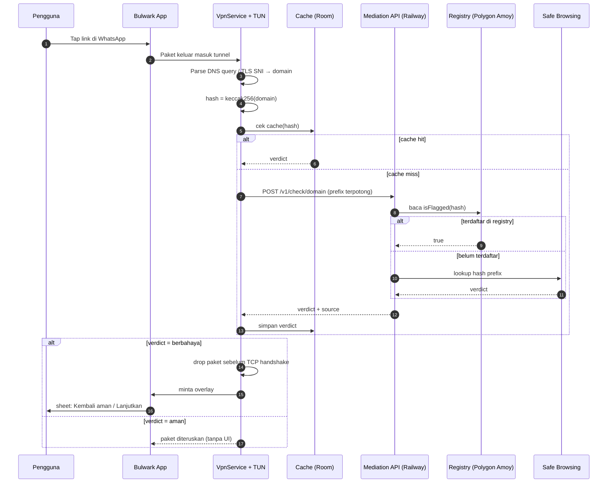
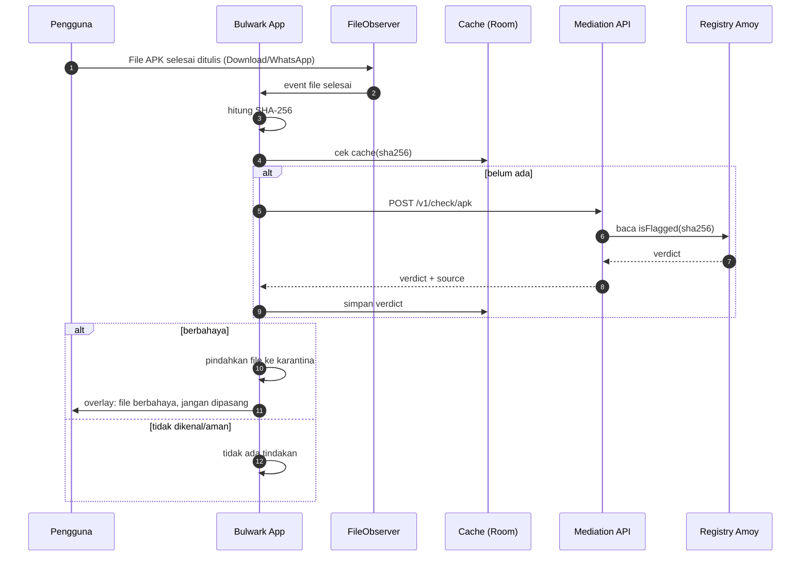
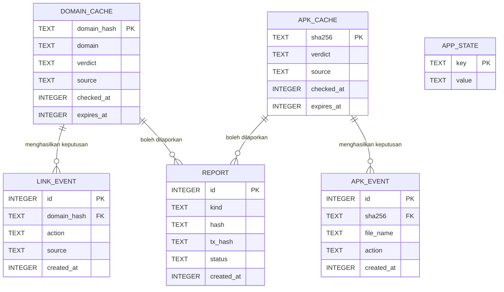

# PRD — Project Requirements Document

**Produk:** Bulwark — perlindungan otomatis link scam & APK berbahaya untuk Android
**Konteks:** Hackathon 24 jam, demo live, tanpa data hardcoded, tanpa mockup, tanpa token/DeFi.

## 1. Overview

**Masalah.** Pengguna Android biasa sering menerima link dan file APK dari nomor tak dikenal di WhatsApp — berkedok undangan nikah, resi paket, atau bantuan sosial. Saat ini mereka mengandalkan insting atau menempelkan link satu per satu ke situs pengecekan, dan biasanya baru sadar setelah terlanjur tap. Tidak ada lapisan perlindungan yang bekerja otomatis di perangkat.

**Tujuan utama Bulwark.**
1. **Memblokir otomatis** link scam sebelum halaman terbuka, langsung di HP pengguna (tanpa server VPN luar).
2. **Mengarantina otomatis** file APK berbahaya yang masuk lewat unduhan atau WhatsApp sehingga tidak bisa dipasang.
3. **Memberi laporan resmi** ke daftar publik (registry on-chain di Polygon Amoy) agar laporan terlihat siapa pun dan membantu pengguna lain.
4. Menjaga pengalaman tetap sederhana: pengguna hanya perlu menyelesaikan 3 izin, lalu perlindungan berjalan sendiri.

**Prinsip produk.** Otomatis dulu, baru menjelaskan. Pengguna tidak perlu mencurigai apa pun — Bulwark yang waspada. Semua angka di layar berasal dari data nyata di perangkat.

## 2. Requirements

**Persyaratan fungsional**
- R1. Aplikasi Android (Kotlin + Jetpack Compose) dengan 4 layar: Onboarding, Beranda, Overlay blokir, Lapor.
- R2. Penyaringan link berjalan lewat `VpnService` lokal + TUN; domain dikenali dari query DNS (prioritas) dan TLS SNI, lalu di-hash dan dicek ke cache perangkat.
- R3. Jika domain ditandai berbahaya, paket **di-drop di dalam tunnel** sebelum TCP handshake selesai, dan overlay peringatan muncul.
- R4. Pemantauan file APK pada folder Download dan media WhatsApp; setelah file selesai ditulis, dihitung SHA-256 dan dicek ke cache/registry. Jika berbahaya → dikarantina + overlay.
- R5. Overlay peringatan berbahasa Indonesia sederhana, **tidak hilang sendiri**, dengan dua pilihan: berhenti atau lanjutkan.
- R6. Mediation API (Node.js, host publik Railway) menerima hash prefix terpotong (bukan URL penuh), membaca registry, fallback ke Google Safe Browsing, dan mengembalikan verdict.
- R7. Registry: kontrak Solidity append-only di Polygon Amoy (chain ID 80002), fungsi tulis (report) dan baca publik; entri dapat dilihat di amoy.polygonscan.com.
- R8. Tombol Lapor mengirim domain/hash APK ke registry dan menampilkan **tx hash asli** hasil transaksi.
- R9. Onboarding tiga izin: filter koneksi lokal, pantau file, peringatan di atas aplikasi. UI tidak memakai kata "VPN".
- R10. Beranda menampilkan status perlindungan dan dua angka nyata (link diblokir, APK dikarantina) dari Room.

**Persyaratan non-fungsional**
- N1. Demo live: seluruh alur harus berfungsi nyata dengan jaringan dan perangkat asli; tidak ada nilai tetap di layar.
- N2. Waktu keputusan blokir di jalur cache ≤ 100 ms agar tidak terasa lambat saat menjelajah.
- N3. Tidak ada intersepsi TLS, tidak ada ML, tidak ada AccessibilityService, tidak ada fitur token/koin/DeFi.
- N4. Teks UI berbahasa Indonesia sederhana; font Inter (fallback font sistem bila waktu tidak cukup).
- N5. Gaya visual mengikuti palet & komponen yang sudah ditetapkan (putih #FFFFFF, navy #0B1B4D, gradien #2456E8→#6A3FE0, permukaan #F3F4F9, kartu terpilih #ECEBFF, garis #E3E6F0, radius kartu 24–28dp, tombol pil 56dp).

**Batasan yang diakui (bukan bug)**
- Hanya satu VPN aktif; jika ada VPN lain, Bulwark tidak bisa menyala — perlu pesan yang jelas.
- Aplikasi biasa tidak bisa memaksa installer menolak instalasi; karena itu karantina memindahkan file, bukan memblokir installer.
- DoH menyembunyikan query DNS → karena itu SNI juga diperiksa.
- Akses folder WhatsApp di Android 11+ butuh izin khusus.

**Di luar scope:** TLS interception, machine learning, iOS, heuristik tambahan, AccessibilityService, fitur token.

**Perlu verifikasi (jangan diasumsikan saat coding)**
- V1. Endpoint & format Google Safe Browsing "v5": perlu dicek ketersediaan dan bentuk request/response-nya. Jika tidak tersedia untuk demo, gunakan Lookup API v4 dengan hash prefix (privasi tetap terjaga karena URL penuh tidak dikirim).
- V2. Cara akses folder WhatsApp di Android 11+: apakah lewat SAF tree picker yang dipilih pengguna (aman untuk kebijakan Play) atau izin lain. **Keputusan teknis harus diambil di jam pertama.**
- V3. Skema hash: apakah registry menyimpan `keccak256(domain)` penuh dan prefix 8 byte sebagai kunci pencarian — harus disepakati sebelum kontrak ditulis agar API dan klien tidak mismatch.
- V4. Kebijakan Play Store soal `MANAGE_EXTERNAL_STORAGE` dan `VpnService` (tidak menghalangi demo hackathon, tapi perlu dicatat).

**Urutan pengerjaan 24 jam (mengikuti prioritas yang ditetapkan)**
1. Skeleton proyek + tema Material 3
2. VpnService + parser DNS + cache + overlay
3. Kontrak registry + Mediation API publik
4. Tombol lapor + sinkronisasi antar HP + layar Lapor
5. FileObserver + SHA-256
6. Layar Beranda + Onboarding
7. Parser SNI

## 3. Core Features

Semua fitur di bawah diambil langsung dari roadmap dan wajib ada saat demo.

### Fase 1 — Beranda Perlindungan
- **Beranda Perlindungan** [high]: layar utama yang menunjukkan perangkat sedang dijaga.
  - **Kartu Status Perlindungan** — kartu gelap navy bergradien berisi "Perlindungan aktif" sebagai penanda utama aplikasi bekerja.
  - **Angka Blokir & Karantina** — jumlah link diblokir dan APK dikarantina, dihitung dari tabel kejadian di Room.
  - **Dua Tile Ringkasan** — dua kotak berdampingan: ringkasan blokir dan info daftar publik.
  - **Tombol Aksi Cepat** — pintasan "Laporkan domain" dan "Buka registry di Polygonscan".
  - *Selesai bila:* menutup lalu membuka ulang aplikasi menampilkan angka yang sama; setelah satu blokir nyata terjadi, angka bertambah 1 tanpa restart manual; tombol Polygonscan membuka `amoy.polygonscan.com` di browser.
  - *Catatan:* layar ini dikerjakan di prioritas ke-6, tetapi struktur navigasinya disiapkan sejak skeleton.

### Fase 2 — Blokir Link Otomatis & Karantina APK
- **Blokir Link Otomatis** [high]
  - **Filter Koneksi Lokal** — VpnService lokal + TUN menyaring langsung di HP, tanpa server VPN eksternal.
  - **Deteksi Alamat Link** — mengenali domain dari query DNS (prioritas) dan TLS SNI, lalu menghitung hash dan mencocokkannya ke cache.
  - **Peringatan di Atas Aplikasi** — overlay `SYSTEM_ALERT_WINDOW` berbahasa sederhana, muncul di atas aplikasi apa pun.
  - **Pilihan Berhenti atau Lanjut** — "Kembali ke aman" (gradien) dan "Lanjutkan dengan risiko sendiri"; overlay tidak menutup sendiri.
  - *Selesai bila:* membuka domain yang sudah ditandai di registry → koneksi gagal, overlay muncul, dan angka blokir bertambah; domain aman → halaman terbuka normal tanpa UI tambahan; overlay tetap ada sampai salah satu tombol ditekan.
- **Karantina APK Berbahaya** [high]
  - **Pantau File Masuk** — FileObserver pada folder Download dan media WhatsApp.
  - **Pemeriksaan Otomatis APK** — setelah penulisan selesai, hitung SHA-256 dan cek ke cache lalu registry.
  - **Pindahkan ke Karantina** — file berbahaya dipindahkan ke direktori karantina milik aplikasi sehingga tidak bisa dibuka/dipasang.
  - **Pemberitahuan File Berbahaya** — overlay menjelaskan nama file dan alasan file tidak boleh dipasang.
  - *Selesai bila:* menaruh APK uji yang hash-nya sudah dilaporkan ke folder target → file hilang dari folder asal, muncul di karantina, overlay tampil, dan angka karantina bertambah; APK tidak dikenal → tidak ada tindakan, tidak ada UI.

### Fase 3 — Lapor ke Daftar Publik & Penyiapan Izin
- **Lapor ke Daftar Publik** [medium]
  - **Pilih Jenis Laporan** — Domain atau APK (kartu pilihan gaya Klarna: outline, terpilih lavender + badge pil).
  - **Kolom Input & Pemeriksaan** — tempat mengetik domain atau memilih file yang dicurigai, dengan validasi agar tidak kosong/format salah.
  - **Kirim ke Daftar Publik** — laporan dicatat ke registry publik lewat Mediation API.
  - **Bukti Transaksi** — kartu hasil berisi tx hash asli setelah transaksi terkirim, dapat dibuka di Polygonscan.
  - **Buka Daftar Publik** — tombol menuju penjelajah blockchain publik.
  - *Selesai bila:* mengirim satu domain → tx hash muncul dan dapat dicari di amoy.polygonscan.com; domain tersebut lalu diblokir di HP kedua dalam ≤ 1 menit (buktikan sinkronisasi antar HP); input kosong ditolak dengan pesan jelas.
- **Penyiapan Izin** [high]
  - **Izin Filter Koneksi Lokal** — kartu penjelasan satu kalimat + tombol izin.
  - **Izin Pantau File** — kartu penjelasan + tombol izin.
  - **Izin Peringatan di Atas Aplikasi** — kartu penjelasan + tombol izin.
  - **Lanjutkan ke Beranda** — tombol lanjut setelah izin diberikan.
  - *Selesai bila:* pada instalasi bersih, pengguna melewati tiga kartu dan berakhir di Beranda; mencabut satu izin lalu kembali ke aplikasi membuat kartu izin itu ditandai belum aktif (status izin dibaca dari sistem, bukan disimpan sebagai asumsi).
  - *Catatan:* kata "VPN" tidak boleh muncul di UI; gunakan "filter koneksi lokal".

### Fase 4 — Daftar Ancaman Terkini & Transparansi
- **Daftar Ancaman Terkini** [medium]
  - **Pengecekan Daftar Publik** — alamat yang belum dikenal dicek ke registry.
  - **Pengecekan Sumber Keamanan Tambahan** — bila tidak ada di registry, dicek ke Google Safe Browsing (lihat V1).
  - **Simpan Hasil di Perangkat** — verdict disimpan di Room dengan masa berlaku, agar pemeriksaan berikutnya cepat dan hemat data.
  - *Selesai bila:* membuka domain yang sama dua kali → panggilan API hanya terjadi sekali (dibuktikan dari log API); hasil cache tetap dipakai setelah aplikasi ditutup.
- **Transparansi Daftar Publik** [low]
  - **Lihat Entri Publik** — membuka daftar entri di penjelajah blockchain.
  - **Info Alamat Daftar** — menampilkan alamat kontrak resmi agar pengguna yakin membuka sumber yang benar.
  - **Status Pembaruan Terakhir** — kapan terakhir daftar ancaman diperbarui di perangkat.
  - *Selesai bila:* alamat kontrak yang tampil sama persis dengan alamat hasil deploy, dan waktu pembaruan terakhir berubah setelah sinkronisasi.

## 4. User Flow

**Alur 0 — Pertama kali buka (kemenangan pertama).**
Buka aplikasi → Onboarding 3 kartu izin → tekan izin satu per satu (status berubah nyata) → "Lanjutkan" → Beranda menampilkan "Perlindungan aktif".

**Alur A — Link scam (Fase 2).**
Tap link di WhatsApp → paket keluar masuk tunnel → domain dikenali dari DNS (atau SNI) → hash → cek cache Room → bila belum ada, cek Mediation API → registry Amoy → Safe Browsing → verdict disimpan ke cache → **berbahaya:** paket di-drop sebelum handshake, overlay navy + sheet putih muncul (domain, sumber "registry Polygon Amoy") → pilih "Kembali ke aman" atau "Lanjutkan dengan risiko sendiri". **Aman:** halaman terbuka tanpa tampilan apa pun.

**Alur B — APK berbahaya (Fase 2).**
File APK selesai diunduh / diterima di WhatsApp → FileObserver mendeteksi penulisan selesai → hitung SHA-256 → cek cache/registry → **berbahaya:** file dipindahkan ke karantina, overlay menjelaskan nama file → pengguna tidak bisa memasangnya. **Tidak dikenal:** tidak ada tindakan.

**Alur C — Melaporkan (Fase 3).**
Beranda → "Laporkan domain" → pilih Domain/APK → isi domain atau pilih file → validasi → "Kirim ke registry" → Mediation API mengirim transaksi → kartu hasil menampilkan tx hash asli → tombol buka Polygonscan.

**Alur D — HP kedua ikut terlindungi (Fase 3–4).**
HP A melaporkan domain → tercatat di registry → HP B (aplikasi lain/instalasi lain) membuka domain yang sama → cache miss → API membaca registry → flagged → diblokir + overlay. Ini bukti sinkronisasi antar perangkat.

**Alur E — Melanjutkan dengan risiko.**
Overlay → "Lanjutkan dengan risiko sendiri" → paket diteruskan untuk domain tersebut pada sesi itu → keputusan dicatat, overlay tertutup.

## 5. Architecture

**Gambaran sistem.** Tiga komponen, sesuai arsitektur final:

1. **Android client (Kotlin, Jetpack Compose, Room/SQLite)** — VpnService lokal dengan TUN; parser DNS & TLS SNI; FileObserver untuk APK; overlay; onboarding; Beranda; Lapor.
2. **Mediation API (Node.js, Railway)** — menerima hash prefix terpotong, membaca registry, fallback ke Google Safe Browsing, mengembalikan verdict; juga menjadi jalur penulisan laporan ke registry.
3. **Registry (Solidity, Polygon Amoy 80002)** — kontrak append-only, tulis (report) dan baca publik, terlihat di amoy.polygonscan.com.

**Endpoint Mediation API (usulan minimal, perlu disepakati bersama kontrak — V3):**
- `POST /v1/check/domain` — `{ prefix: hex8, hash?: hex32 }` → `{ verdict: "malicious"|"safe"|"unknown", source: "registry"|"safebrowsing"|"none" }`
- `POST /v1/check/apk` — `{ sha256: hex32 }` → verdict yang sama
- `POST /v1/report` — `{ kind: "domain"|"apk", hash: hex32 }` → `{ txHash: hex }`
- `GET /v1/health` — status API + alamat kontrak + chain ID

**Catatan penulisan on-chain:** HP pengguna tidak memegang wallet. Transaksi tulis dikirim oleh wallet milik backend (private key di environment variable Railway). Ini keputusan yang harus disadari: perlu rate limit sederhana agar tidak disalahgunakan. *Perlu verifikasi/keputusan tim di jam pertama.*





## 6. Database Schema

Tidak ada database server. Yang ada: **cache lokal di perangkat (Room/SQLite)** dan **registry on-chain** sebagai sumber kebenaran publik.

**Tabel Room**

| Tabel | Field utama | Tipe | Kegunaan |
|---|---|---|---|
| `domain_cache` | `domain_hash` (PK), `domain`, `verdict`, `source`, `checked_at`, `expires_at` | TEXT, TEXT, TEXT, TEXT, INTEGER, INTEGER | Menyimpan hasil cek domain agar tidak memanggil API berulang. |
| `apk_cache` | `sha256` (PK), `verdict`, `source`, `checked_at`, `expires_at` | TEXT, TEXT, TEXT, INTEGER, INTEGER | Cache hasil cek file APK. |
| `link_event` | `id` (PK), `domain_hash` (FK), `domain`, `action` (`blocked`/`allowed`), `source`, `created_at` | INTEGER, TEXT, TEXT, TEXT, TEXT, INTEGER | Riwayat setiap keputusan link; sumber angka "link diblokir". |
| `apk_event` | `id` (PK), `sha256` (FK), `file_name`, `original_path`, `quarantine_path`, `action` (`quarantined`/`ignored`), `created_at` | INTEGER, TEXT, TEXT, TEXT, TEXT, TEXT, INTEGER | Riwayat file APK; sumber angka "APK dikarantina". |
| `report` | `id` (PK), `kind` (`domain`/`apk`), `hash`, `tx_hash`, `status` (`pending`/`sent`/`failed`), `created_at` | INTEGER, TEXT, TEXT, TEXT, TEXT, INTEGER | Menyimpan bukti laporan dan tx hash asli untuk layar Lapor. |
| `app_state` | `key` (PK), `value` | TEXT, TEXT | Menyimpan hal teknis seperti alamat kontrak, chain ID, dan `last_sync_at` untuk "status pembaruan terakhir". |

**Registry on-chain (Solidity, Polygon Amoy 80002)** — append-only, tanpa fungsi hapus:

| Penyimpanan | Tipe | Kegunaan |
|---|---|---|
| `entries` | `mapping(bytes32 => Entry)` | Data entri: `hash`, `kind` (1 = domain, 2 = APK), `reportedAt`, `reporter` (alamat backend). |
| `flaggedPrefix` | `mapping(bytes8 => bool)` | Pencarian cepat dari hash prefix terpotong yang dikirim klien, tanpa membocorkan URL penuh. |
| `totalReports` | `uint256` | Jumlah entri; dipakai untuk transparansi "entri publik". |
| Event `Reported(bytes32 hash, uint8 kind, uint256 at)` | event | Bukti append-only yang bisa dilihat di Polygonscan. |

*Perlu verifikasi (V3):* apakah prefix 8 byte cukup aman dari tabrakan untuk demo, atau perlu 12 byte. Keputusan ini memengaruhi kontrak, API, dan klien sekaligus.



## 7. Tech Stack

| Lapisan | Teknologi | Catatan |
|---|---|---|
| Aplikasi Android | Kotlin, Jetpack Compose, Material 3 (tema kustom) | Font Inter, fallback font sistem bila waktu habis. |
| Penyimpanan lokal | Room di atas SQLite | Semua angka di Beranda dibaca dari sini. |
| Jaringan lokal | `VpnService` + TUN, parser DNS, parser TLS SNI | Tanpa server VPN eksternal, tanpa intersepsi TLS. |
| Pemantauan file | `FileObserver` + SHA-256 | Cakupan folder sesuai V2. |
| Overlay | `SYSTEM_ALERT_WINDOW` + Compose/View | Tidak menutup sendiri, dua pilihan aksi. |
| Backend | Node.js (Express/Fastify) | Deploy ke Railway; endpoint seperti di bagian Architecture. |
| Blockchain | Solidity + Hardhat + ethers, Polygon Amoy (80002) | Deploy manual via skrip Hardhat; verifikasi di Polygonscan. |
| Deployment | Railway (API), Amoy (kontrak), Android (APK rilis debug untuk demo) | Tidak ada database server. |

**Struktur repo yang diusulkan**

```
bulwark/
├── android/                      # Kotlin + Compose
│   └── app/src/main/java/id/bulwark/
│       ├── ui/                   # theme/, onboarding/, home/, report/, overlay/
│       ├── vpn/                  # BulwarkVpnService.kt, DnsParser.kt, SniParser.kt
│       ├── files/                # ApkWatcher.kt, HashUtil.kt, Quarantine.kt
│       ├── data/                 # AppDatabase.kt, entities/, dao/, Repository.kt
│       ├── net/                  # MediationApi.kt
│       └── overlay/              # OverlayController.kt
├── backend/                      # Node.js Mediation API
│   └── src/
│       ├── index.js              # server + routes
│       ├── services/registry.js  # baca/tulis kontrak via ethers
│       └── services/safebrowsing.js
├── contracts/                    # Hardhat
│   ├── contracts/Registry.sol
│   ├── scripts/deploy.js
│   └── test/Registry.test.js
└── README.md                     # alamat kontrak, URL API, cara demo
```

**Task list kecil berurutan dengan kriteria selesai**

1. **Skeleton + tema** — proyek Android kosong, Material 3 dengan palet & komponen (tombol pil 56dp, kartu 24–28dp), navigasi 3 ikon. *Selesai bila:* aplikasi terpasang, Beranda kosong tampil dengan warna yang benar, tidak ada crash.
2. **VpnService + parser DNS + cache + overlay** — service berjalan, DNS diparse, hash dicek ke Room, uji dengan domain yang sudah dilaporkan. *Selesai bila:* domain flagged gagal dibuka, overlay muncul, angka event tercatat; domain aman terbuka normal.
3. **Kontrak registry + API publik** — `Registry.sol` ter-deploy di Amoy, `/v1/check/domain` dan `/v1/health` hidup di Railway. *Selesai bila:* memanggil endpoint dengan hash yang sudah dilaporkan mengembalikan `malicious`, dan entri terlihat di Polygonscan.
4. **Tombol lapor + layar Lapor + sinkronisasi** — form validasi, `POST /v1/report`, tx hash tampil, HP kedua ikut memblokir. *Selesai bila:* tx hash asli bisa dibuka di Polygonscan dan HP kedua memblokir domain itu dalam ≤ 1 menit.
5. **FileObserver + SHA-256 + karantina** — APK uji dipindahkan, overlay muncul. *Selesai bila:* file hilang dari folder asal, ada di karantina, angka karantina bertambah.
6. **Beranda + Onboarding** — status izin dibaca dari sistem, dua angka dari Room. *Selesai bila:* instalasi bersih melewati onboarding dengan tiga izin nyata dan Beranda menampilkan angka yang berubah setelah blokir.
7. **Parser SNI** — domain dikenali saat DNS tersembunyi (DoH). *Selesai bila:* membuka domain flagged lewat jalur yang memakai DoH tetap terblokir.

**Perlu verifikasi sebelum coding (ringkas):** endpoint & ketersediaan Safe Browsing v5 (V1), cara akses folder WhatsApp di Android 11+ (V2), skema hash & panjang prefix (V3), kebijakan Play untuk izin yang dipakai (V4).

## Keputusan teknis (menimpa bagian lain bila bertentangan)
1. Urutan kerja mengikuti "Urutan pengerjaan 24 jam", BUKAN nomor Fase di Core Features.
2. VpnService mode DNS saja: set DNS server tunnel ke alamat virtual dan route hanya alamat itu ke TUN. Domain berbahaya dijawab NXDOMAIN, query aman diteruskan ke DNS asli lewat socket yang di-protect(). Jangan implementasi forwarding TCP penuh. SNI hanya setelah semua fitur lain jalan.
3. Kecualikan paket aplikasi Bulwark sendiri dari tunnel (addDisallowedApplication) supaya panggilan ke API tidak loop.
4. Hash: SHA-256 untuk domain dan APK (tersedia di Android tanpa library). Jangan keccak256. Prefix 8 byte. Menutup V3.
5. Domain dinormalisasi sebelum di-hash: huruf kecil, tanpa titik di akhir. Klien dan API wajib memakai aturan yang sama.
6. TTL cache untuk verdict "safe" dan "unknown" maksimal 30 detik (demo sinkronisasi HP B butuh ini). TTL "malicious" boleh panjang.
7. Fungsi report di kontrak hanya boleh dipanggil wallet backend (onlyOwner). Endpoint POST /v1/report wajib header token bersama dari env var plus rate limit sederhana.
8. Safe Browsing: baca dokumentasi resmi sebelum coding, jangan mengarang endpoint. PRD menyebut v4 Lookup memakai hash prefix; setahu penulis Lookup v4 mengirim URL penuh, jadi VERIFIKASI. Kalau bermasalah, tandai TODO dan lanjut, jangan blokir pekerjaan lain.
9. Folder API bernama backend/ (bukan api/). Server membaca process.env.PORT. Sediakan GET /health yang mengembalikan {"ok":true} selain GET /v1/health. Rahasia hanya di env var; .env.example hanya nama variabel (PRIVATE_KEY, AMOY_RPC_URL, SAFE_BROWSING_KEY, REGISTRY_ADDRESS, API_SHARED_TOKEN).
10. V2 (folder WhatsApp): coba izin All files access dulu dan uji di HP asli sebelum membangun yang lain.
11. Git: agent TIDAK menjalankan perintah git yang menulis (add, commit, pull, push, rebase). Commit dan push dilakukan Hermes per worktree.
